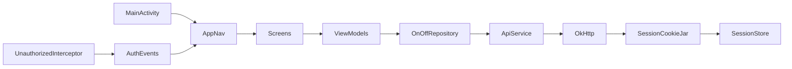

# Architecture report — OnOffMyPC mobile

**Repo:** `onoffmypc-mobile`  
**Audited:** 2026-07-16  
**Primary target:** Android (`android/`) — Jetpack Compose, version **0.3.8** (`versionCode` 15)  
**Secondary:** iOS (`ios/`) — SwiftUI, iOS 16+, XcodeGen  

This document describes the **current** architecture. It is not a redesign proposal. Incremental evolution guidance lives in [`MOBILE_ROADMAP.md`](MOBILE_ROADMAP.md) and [`KMP_MIGRATION_PLAN.md`](KMP_MIGRATION_PLAN.md).

---

## 1. Repository layout

```
onoffmypc-mobile/
├── android/                 # Gradle root; modules :app + :shared:model
│   ├── app/src/main/kotlin/com/onoffmypc/android/
│   ├── shared/model/        # JVM Kotlin DTOs (com.onoffmypc.shared.model)
│   ├── gradle/libs.versions.toml
│   └── settings.gradle.kts  # include(":app"), include(":shared:model")
├── ios/                     # XcodeGen; SwiftUI client
│   ├── project.yml
│   └── OnOffMyPC/
├── docs/                    # Architecture, UX, KMP, security pointer
├── distribution/            # Play Store whatsnew snippets
├── playstore/               # Listing / first-upload notes
├── scripts/                 # Release helpers
└── .github/workflows/       # Android CI/release + iOS simulator CI
```

Android now has a JVM `:shared:model` module for API DTOs / `CommandType` / `ApiException` (`:app` re-exports via typealiases). There is still **no** KMP `commonMain`, **no** `:shared:network`, and iOS still duplicates models independently.

---

## 2. Android architecture

### 2.1 Pattern

| Layer | Implementation | Location |
|---|---|---|
| UI | Jetpack Compose + Material 3 | `ui/**` |
| Navigation | Navigation Compose 2.8.3 | `ui/navigation/AppNav.kt` |
| State | MVVM + `StateFlow` / `collectAsStateWithLifecycle` | `*ViewModel.kt` |
| DI | Manual singleton `Graph` | `Graph.kt`, init in `OnOffApp.kt` |
| Domain/data | Single `OnOffRepository` | `data/OnOffRepository.kt` |
| Shared models | JVM module `:shared:model` | `shared/model/` → `com.onoffmypc.shared.model` |
| Network | Retrofit 2.11 + OkHttp 4.12 + kotlinx.serialization | `data/remote/` |
| Auth session | Cookie jar → encrypted prefs | `SessionCookieJar.kt`, `SessionStore.kt` |
| Push | FCM (optional until `google-services.json`) | `push/` |

**Single-Activity:** `MainActivity` hosts `OnOffMyPCTheme { AppNav() }`.



### 2.2 Package map

```
com.onoffmypc.android/
  MainActivity.kt, OnOffApp.kt, Graph.kt
  data/
    Constants.kt              # Api.BASE_URL
    SessionStore.kt           # EncryptedSharedPreferences
    OnOffRepository.kt        # All API call sites + Result mapping
    model/Models.kt           # Typealiases → :shared:model
    ApiErrorMapping.kt        # mapHttpFailure / isTrialLockError
    remote/
      ApiService.kt           # Retrofit interface
      ApiClient.kt            # OkHttp + Retrofit factory
      SessionCookieJar.kt
      UnauthorizedInterceptor.kt
      AuthEvents.kt           # SharedFlow for 401 → login
      KotlinxJsonConverterFactory.kt
  push/
    OnOffMessagingService.kt, PushManager.kt,
    Notifications.kt, NotificationPermission.kt
  ui/
    theme/Color.kt, Theme.kt
    navigation/AppNav.kt
    auth/                     # Login, Register, Forgot, OIDC helpers
    devices/                  # List, Detail, dialogs
    account/, billing/
    components/               # PowerControls, status/command presentation, …
```

### 2.3 Navigation

Routes in `AppNav.kt`:

| Route | Screen |
|---|---|
| `login` | `LoginScreen` |
| `register` | `RegisterScreen` |
| `forgot` | `ForgotPasswordScreen` |
| `devices` | `DevicesScreen` (post-auth home) |
| `account` | `AccountScreen` |
| `billing?deviceId=` | `BillingScreen` |
| `device/{deviceId}` | `DeviceDetailScreen` |

Start destination: `devices` if `Graph.session.session != null`, else `login`.  
`AuthEvents.unauthorized` pops to login on HTTP 401.

### 2.4 Networking & auth

- **Base URL:** `https://api.onoffmypc.com` (`data/Constants.kt`).
- **Auth:** Cookie-based. Login / social auth set an HttpOnly-style `session` cookie; `SessionCookieJar` persists the cookie **value** via `SessionStore` (`EncryptedSharedPreferences` + `MasterKey` AES256-GCM).
- **401:** `UnauthorizedInterceptor` clears session and emits `AuthEvents.unauthorized`.
- **Logging:** OkHttp `HttpLoggingInterceptor` **BASIC** only when `BuildConfig.DEBUG`.
- **JSON:** kotlinx.serialization with `ignoreUnknownKeys = true`.
- **Note:** Comment in `Constants.kt` mentioning “Bearer token” is stale; the live path is cookie session only.

### 2.5 Push (Android)

- FCM messaging service, token register/unregister against `POST /push/register` and `/push/unregister`.
- Runtime `POST_NOTIFICATIONS` on API 33+.
- Plugin and runtime are **inert** without `app/google-services.json` (see `PUSH.md`).
- Logout unregisters the token while the session is still valid (`PushManager.unregisterIfPossible`).

### 2.6 Build / CI

- AGP 8.6.1, Kotlin 2.0.20, Compose BOM 2024.09.03, `minSdk 26`, `targetSdk`/`compileSdk` 35, JDK 17.
- Release: R8 **disabled** (`isMinifyEnabled = false`); signing from env / `.env` / `keystore.properties`.
- Workflows: `ci.yml`, `release.yml`, `aab.yml`, `play.yml`, `release-verify.yml`, `ios-ci.yml`.

---

## 3. iOS architecture

### 3.1 Pattern

| Layer | Implementation | Location |
|---|---|---|
| UI | SwiftUI | `Features/**`, `Components/**` |
| State | `ObservableObject` ViewModels | `*ViewModel.swift` |
| Network | `URLSession` + cookie jar | `Networking/APIClient.swift` |
| Session | Keychain (`Session.cookie`) | `Networking/Session.swift` |
| Models | `Codable` mirrors of API | `Networking/Models.swift` |

Entry: `OnOffMyPCApp.swift` — root switches login vs devices from `Session.isLoggedIn`.

Feature folders mirror Android: Auth, Devices, Account, Billing. Shared UI lives in `Components/` (`PowerCommandControls`, `DeviceStatusSummary`, `TokenReveal`, `AppLogo`, `PasswordField`).

### 3.2 Parity vs Android

| Capability | Android | iOS |
|---|---|---|
| Email auth + register + forgot | Yes | Yes |
| Google / Apple / Microsoft (config-gated) | Yes | Yes |
| Devices CRUD + token rotate + reveal | Yes | Yes |
| Power on/off/force/reset + confirmations | Yes | Yes |
| Connection vs PC state vs last contact | Yes | Yes |
| Telemetry + 7-day temp chart | Yes | Yes |
| Command history + honest queue labels | Yes | Yes |
| Per-device billing / Polar checkout / `billing_enabled` | Yes | Yes |
| Account security / delete / cancel deletion | Yes | Yes |
| Push notifications | FCM wired | Stub only (`Session.pushToken`; no APNs pipeline in-repo) |
| Store / TestFlight release workflow | Play/AAB workflows | Simulator CI only |

iOS is a **parallel native client**, not a shared-code port. Drift risk is real (models and copy are manually kept in sync).

---

## 4. Feature coverage vs product surface

Interpreted against the product list in the audit brief and current `README.md` / changelog.

| Product area | Status | Notes |
|---|---|---|
| Wake / power on | **Shipped** | `CommandType.POWER_ON` |
| Shutdown / power off | **Shipped** | Soft press + force hold |
| Restart / reset | **Shipped** | `RESET` |
| Sleep | **Not in clients** | No wire type / UI |
| Hibernate | **Not in clients** | No wire type / UI |
| Command queue UX | **Partial** | Offline → “queued”; no dedicated queue screen/management |
| Device status | **Shipped** | Online / offline / unknown + last contact |
| Telemetry | **Shipped** | Latest + history chart (temp focus) |
| Notifications | **Android shipped** | iOS not production-wired |
| Command history | **Shipped** | Detail screen list |
| Ownership transfer | **Missing** | No API UI in mobile |
| Firmware | **Display only** | `firmware_version` shown; no OTA/update flow |
| Billing | **Shipped** | Trial + one-time unlock + Polar hosted checkout; store-billing policy caveat |

---

## 5. Security posture (mobile-scoped)

| Topic | Current state |
|---|---|
| Session storage | Android: EncryptedSharedPreferences; iOS: Keychain |
| Backup | `android:allowBackup="false"` |
| Transport | HTTPS to `api.onoffmypc.com` |
| Certificate pinning | **Not implemented** |
| Biometrics / app lock | **Not implemented** |
| HTTP logging | Debug-only BASIC |
| ProGuard/R8 | Off for release |
| Secrets in APK | Polar credentials not shipped; OAuth client IDs via BuildConfig / Swift constants |
| Assessment | Pointer only: [`SECURITY_ASSESSMENT.md`](SECURITY_ASSESSMENT.md) → private cross-repo docs |

---

## 6. Testing

| Kind | Status |
|---|---|
| Unit tests (`src/test`) | **Present** — `CommandPresentation`, status helpers, `ApiErrorMapping`, fleet summary; `:shared:model` serialization |
| Instrumented / Compose UI tests | **None** |
| iOS XCTest | **None** in repo |

CI validates **compile** (Android assemble / iOS simulator build), not behavior.

---

## 7. Technical debt hotspots

1. **Duplicated Android/iOS domain layer** — models, command status copy, billing eligibility helpers.
2. **Monolithic `OnOffRepository` + fat screens** — presentation helpers exist, but screens still own large Compose trees (e.g. `DevicesScreen.kt`, `DeviceDetailScreen.kt`, `BillingScreen.kt`).
3. **No automated tests** around command feedback, connection heuristics (`connectionFromLastContact`), or billing gates.
4. **R8 off** — larger APK; reflection/keep rules deferred.
5. **Stale comments** (Bearer vs cookie) and emoji hamburger (`☰`) as menu affordance.
6. **Store billing** — Polar browser checkout conflicts with Play/App Store IAP rules for digital unlocks on those storefronts (`README.md` policy section).
7. **iOS push gap** — Keychain session is solid; push registration is preparatory only.
8. **Constants / Graph as globals** — fine at current size; will need seams before KMP extraction and unit tests.

---

## 8. Honest assessment vs “world-class”

**Strengths:** Clear MVVM, honest command/status language, encrypted session, thin dependency surface, feature-complete core control loop on Android, strong iOS feature parity for auth/devices/billing UI.

**Gaps vs world-class:** No KMP shared core yet (JVM `:shared:model` only), thin unit-test coverage, incomplete security hardening (pinning, biometrics, R8), incomplete product surface (sleep/hibernate/ownership/firmware OTA), iOS push and store distribution unfinished.

**Recommended posture:** Evolve Android in place; extract shared logic for KMP only after seams and tests exist. Do **not** rewrite the Compose UI or replace SwiftUI wholesale in one jump.

---

## 9. Target modular shape (evolution)

Keep UI in `:app` (and SwiftUI on iOS). Extract inward:

```
android/
  settings.gradle.kts
    include(":app")
    include(":shared:model")      # Done — DTOs / CommandType / ApiException
    include(":shared:network")    # Phase 2c — API interface (later)
    include(":shared:data")       # Phase 2d — repository (later)
  app/                            # Compose UI, Graph, push, session wiring
  shared/
    model/                        # Pure Kotlin JVM (+ serialization) — present
    network/                      # Optional follow-on
    data/                         # Optional follow-on
```

Design-system Compose primitives stay under `app/.../ui/designsystem/` until a CMP UI phase (if ever). See [`KMP_MIGRATION_PLAN.md`](KMP_MIGRATION_PLAN.md).
